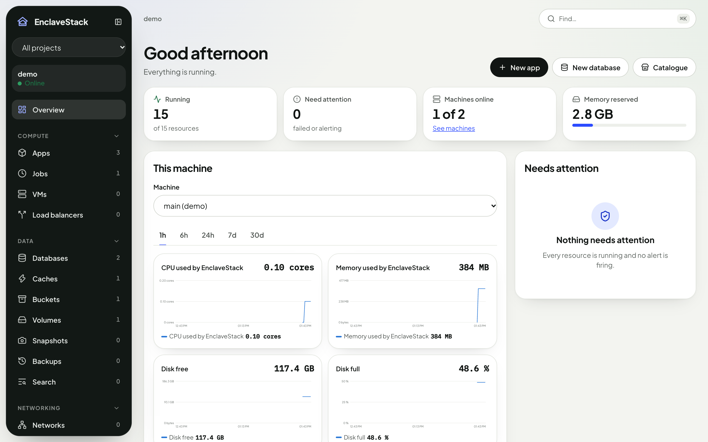
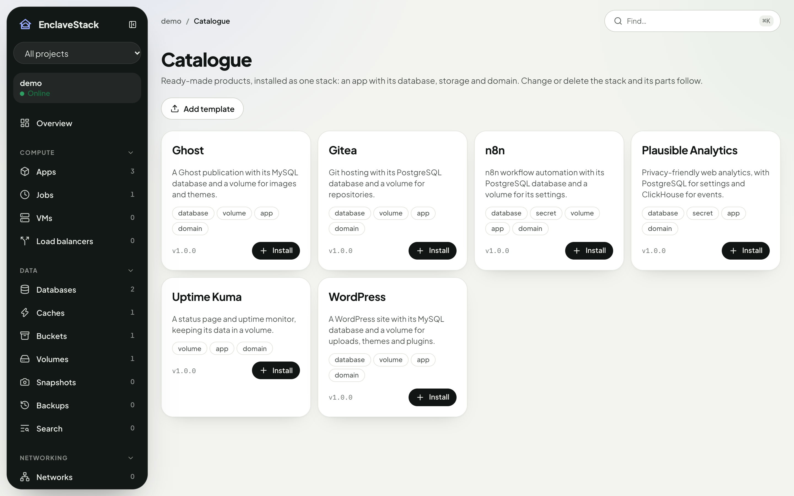
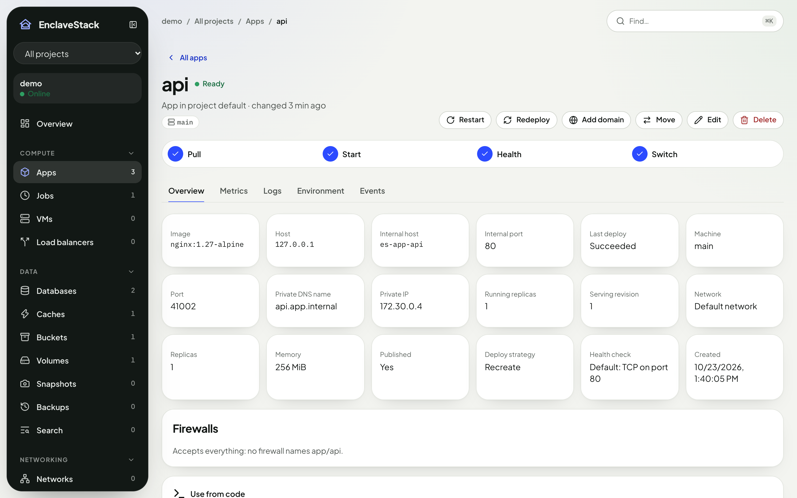
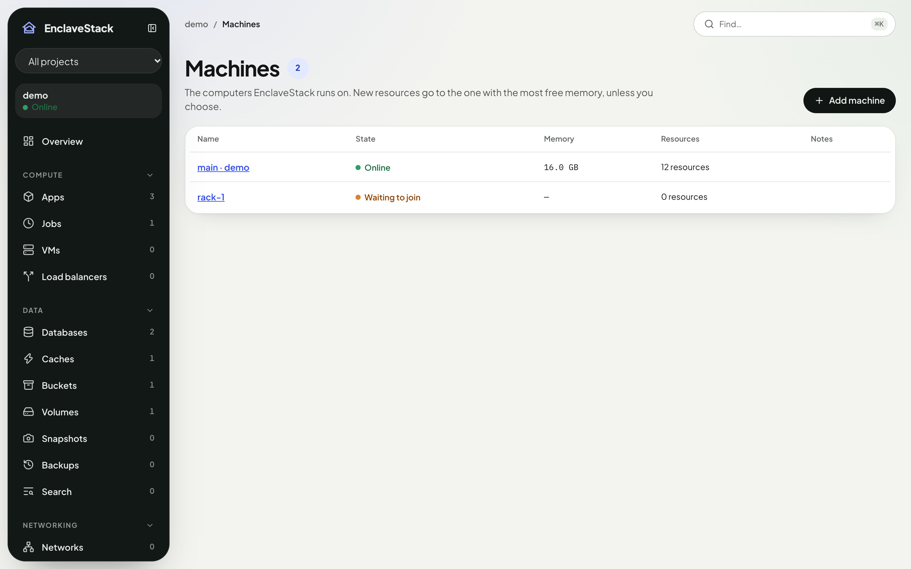
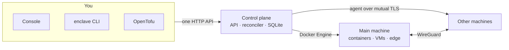

<div align="center">

<a href="https://enclavestack.soupler.com"></a>

# EnclaveStack

### Your own cloud, on your own machines.

**Apps, databases, caches, buckets, VMs and more — on a Mac or Linux box you already have, from a console, a CLI or OpenTofu.**

[](LICENSE)
[](go.mod)
[](#status)
[](#quick-start)

**[Website](https://enclavestack.soupler.com)** · **[Docs](https://enclavestack.soupler.com/docs/)** · **[Services](https://enclavestack.soupler.com/services/)**

[Quick start](#quick-start) · [What you get](#what-you-get) · [Three ways to drive it](#three-ways-to-drive-it) · [Many machines](#many-machines) · [How it works](#how-it-works) · [FAQ](#faq) · [Documentation](#documentation)

</div>

<br />

<div align="center">
<picture>
  <source media="(prefers-color-scheme: dark)" srcset=".github/assets/console-dark.png" />
  
</picture>
</div>

---

Paying a cloud bill for side projects, a small team or a homelab? EnclaveStack turns the computers you already own into the services you'd rent:
- run any container as an app;
- give it a PostgreSQL database and a Redis cache;
- store files in S3-compatible buckets;
- keep its keys as encrypted secrets;
- put it behind a domain with HTTPS;
- and back it all up on a schedule.

It is one program. Install it and open the console. Everything after that is a click, a command or a line of OpenTofu away: networks, firewalls, load balancers, VMs, metrics, alerts. Add a second computer and your resources spread across both.

## Quick start

There is no download yet, so you build EnclaveStack from the source code. Pick what you want to do:

| I want to… | Use | You need |
|---|---|---|
| **Look around**: click through the console with sample data, and nothing real is created | [Option 1: try it](#option-1-try-it-with-sample-data) | Go, Node and pnpm |
| **Use it**: run real databases and apps on this computer | [Option 2: run it for real](#option-2-run-it-for-real) | the same, plus Docker |

Go 1.26+, Node 22.12+ and pnpm 9 are needed by both. Only VMs need **QEMU** (`brew install qemu`, or `qemu-system` and `qemu-utils` on Linux); skip it until you want one.

### Option 1: try it with sample data

```bash
git clone https://github.com/EnclaveStack/platform.git enclavestack && cd enclavestack
pnpm install
make demo
```

When it says *EnclaveStack is running*, open **http://127.0.0.1:7070** and sign in as `admin@enclave.local` with the password `enclave-demo`. It starts with sample apps, databases, a cache, a bucket, a job, a WordPress site and a second project, all on a simulated engine, so no Docker is needed. Press Ctrl-C to stop it and remove everything.

### Option 2: run it for real

**1. Build and start it.**

```bash
git clone https://github.com/EnclaveStack/platform.git enclavestack && cd enclavestack
pnpm install && make build     # builds the program, ./build/enclave, with the console inside
./build/enclave server         # leave this running; it prints a web address and a one-time setup code
```

**2. Create your account.** Open **http://127.0.0.1:7070**, enter the setup code and choose an email and password. You are now in the console, which is empty.

**3. Make something**, from the console or from a second terminal. Sign the terminal in once, then try any of these (each is an example, not a required step):

```bash
./build/enclave login                                                   # sign the terminal in as you
./build/enclave db create orders --wait                                 # a PostgreSQL database
./build/enclave app create web --image nginx:1.27-alpine --port 80 --publish --wait   # a web app from a container image
./build/enclave stack create blog --template wordpress --param domain=blog.localhost --wait  # a WordPress site, with its database and storage
./build/enclave ls                                                      # list everything you have
```

`--wait` makes the command wait until the thing is ready. Everything you create from the terminal also appears in the console, and the other way round. The same things can be declared as code with [OpenTofu](#three-ways-to-drive-it).

## What you get

| Service | What it is | Think of it as |
|---|---|---|
| **Apps** | Any container image, or a Git repository with a Dockerfile. Replicas and zero-downtime deploys with health checks | ECS / Cloud Run |
| **Databases** | PostgreSQL, MySQL, MongoDB or ClickHouse, with a managed password | RDS |
| **Caches** | Redis, persisted to disk | ElastiCache |
| **Buckets** | S3-compatible object storage | S3 |
| **Secrets** | Encrypted values your apps get as environment variables, or read from Vault, 1Password, AWS, Doppler or Infisical | Secrets Manager |
| **Domains** | Hostnames with automatic HTTPS (Let's Encrypt, or a local CA) | ALB + ACM |
| **Jobs and backups** | Scheduled commands, and scheduled dumps with one-click restore | EventBridge + AWS Backup |
| **Networks and firewalls** | Private networks with subnets and private DNS, and allow rules between resources | VPC + security groups |
| **Load balancers and DNS** | HTTP or TCP balancing across replicas, and DNS zones and records at Cloudflare or Route 53 | ELB + Route 53 |
| **VMs, volumes and snapshots** | Whole machines on QEMU with SSH, plus disks and folders that outlive what uses them | EC2 + EBS |
| **Queues, topics, search, email, CDN and transcoding** | NATS JetStream, OpenSearch, SMTP with a message viewer, a caching edge and FFmpeg | SQS, SNS, OpenSearch, SES, CloudFront, MediaConvert |
| **Operate** | Projects, people and roles, metrics and dashboards, alerts (email, Slack, Discord, Telegram or webhooks) and log export | IAM + CloudWatch |
| **Catalogue** | WordPress, Ghost, n8n, Uptime Kuma, Gitea and Plausible, or your own template, installed as one stack | Marketplace |

<div align="center">
<picture>
  <source media="(prefers-color-scheme: dark)" srcset=".github/assets/catalogue-dark.png" />
  
</picture>
</div>

## Three ways to drive it

Everything goes through one API, and every capability works from all three. Use whichever fits the moment, and switch any time: each resource's page in the console shows its CLI command and its OpenTofu block.

<table>
<tr><th>Console</th><th>CLI</th><th>OpenTofu / Terraform</th></tr>
<tr valign="top">
<td>

Open `http://127.0.0.1:7070`: lists with search, live progress, logs, metrics and one-click actions.

</td>
<td>

```bash
enclave db create orders --wait
enclave app create api \
  --image ghcr.io/acme/api:1.4 \
  --port 8080 \
  --secret-env DB_PASSWORD=orders-password
```

</td>
<td>

```hcl
resource "enclave_database" "orders" {
  name = "orders"
}

resource "enclave_app" "api" {
  name  = "api"
  image = "ghcr.io/acme/api:1.4"
  port  = 8080
}
```

</td>
</tr>
</table>

See [`examples/opentofu`](examples/opentofu) for a full configuration.

<div align="center">
<picture>
  <source media="(prefers-color-scheme: dark)" srcset=".github/assets/app-dark.png" />
  
</picture>
</div>

## Many machines

Got an old laptop or a mini PC? Join it, and EnclaveStack places new resources wherever there is room.

```bash
enclave machine add rack-1 --label disk=ssd     # prints a one-time join command
# on the other computer:
enclave agent join http://<main machine>:7070 --code <code>
```

- **Placement**: by free memory, by name (`--machine rack-1`) or by label (`--machine-label disk=ssd`).
- **Private networks span machines** over an encrypted WireGuard tunnel, so an app on one reaches a database on the other by name.
- **When a machine goes offline**, its apps restart elsewhere, and data waits for its machine.
- **Move** anything, data included: `enclave move database/orders --to main`. **Drain** a machine before you unplug it.

<div align="center">
<picture>
  <source media="(prefers-color-scheme: dark)" srcset=".github/assets/machines-dark.png" />
  
</picture>
</div>

## How it works



You describe what you want, and the **control plane** stores it. A **reconciler** then makes it happen, retrying until it succeeds, and puts it back if something drifts. Resources run as Docker containers on your machines, and VMs run under QEMU. State lives in one SQLite file. Secrets are encrypted with a master key that never leaves your machine, and nothing phones home.

## Status

| Release | What it adds | State |
|---|---|---|
| v0.2 | Apps, databases, caches, buckets and secrets; the console, the CLI and the OpenTofu provider | Built |
| v0.3 | Zero-downtime deploys, domains with HTTPS, jobs, backups and restore, builds from Git | Built |
| v0.4 | Networks, firewalls, replicas and load balancers, DNS zones and records | Built |
| v0.5 | VMs, volumes and snapshots | Built |
| v0.6 | MySQL, MongoDB, ClickHouse, queues, topics, search, email, CDN and transcoding | Built |
| v0.7 | Projects, roles, metrics, dashboards, alerts, log export and outside secret stores | Built |
| v0.8 | Many machines, moving resources and the catalogue | Built |

Every release above is tested on all three surfaces and on real Docker, but none is published yet. Not yet tried by hand:
- two physical computers joined over a network;
- a few real third-party services: Slack, Discord and Telegram, a real email relay, and 1Password, AWS, Doppler and Infisical.

The full roadmap is in [`L1-002`](docs/L1-strategy/L1-002-coolify-study-and-service-roadmap-v1.md).

## FAQ

<details>
<summary><strong>Who is this for?</strong></summary>

Developers, small teams and homelabbers who want cloud-style services without a cloud bill or a cloud account, and without hand-writing Docker Compose files for every project.
</details>

<details>
<summary><strong>Does anything leave my machine?</strong></summary>

No: there is no account and no telemetry. Data leaves only where you send it:
- images you pull;
- certificates you request;
- destinations you set up yourself, such as backups to S3, alerts to Slack or log export.
</details>

<details>
<summary><strong>How is this different from Coolify or Dokku?</strong></summary>

Those focus on deploying apps. EnclaveStack aims at the whole small cloud: databases, buckets, networks, firewalls, VMs, queues, metrics and alerts. The console, the CLI and an OpenTofu provider all share one API, so you can click today and keep it as code tomorrow.
</details>

<details>
<summary><strong>Mac or Linux?</strong></summary>

Both. On a Mac, it uses Docker Desktop (or another Docker Engine), and QEMU with Apple's Hypervisor framework for VMs. On Linux, it uses Docker, and QEMU with KVM.
</details>

<details>
<summary><strong>Can I try it without Docker?</strong></summary>

Yes. `enclave server --driver fake` simulates the engine. For the console alone, `cd console && VITE_ENCLAVE_API=mock pnpm dev` runs it against an in-browser demo; sign in with `admin@enclave.local` / `enclave-demo`.
</details>

<details>
<summary><strong>Is it production-ready?</strong></summary>

Not yet: it is pre-release. Each release is built and tested, but there is no published version or upgrade promise yet.
</details>

## Documentation

- **Guides and every service, explained**: [enclavestack.soupler.com/docs](https://enclavestack.soupler.com/docs/)
- **Architecture**: [`L3-001`](docs/L3-architecture/L3-001-system-architecture-v1.md)
- **API**: [`L3-002`](docs/L3-architecture/L3-002-console-api-contract-v1.md) and [`api/openapi.yaml`](api/openapi.yaml)
- **Security**: [`L3-006`](docs/L3-architecture/L3-006-security-architecture-v1.md)
- **Local setup and troubleshooting**: [`L4-001`](docs/L4-infrastructure/L4-001-local-dev-setup-v1.md)
- **What each feature does, step by step**: [`L5-001`](docs/L5-operations/L5-001-feature-test-playbook-v1.md)
- **Changes**: [`CHANGELOG.md`](CHANGELOG.md)

## Contributing

Issues and pull requests are welcome. **Read [CONTRIBUTING.md](CONTRIBUTING.md) first**: how to report a bug or suggest a feature, how work is tracked, and how a pull request gets reviewed and merged. In short: branch from `develop` (`<type>/<slug>`), open the PR against `develop`, and fill in every section of the template. Questions go to [Discussions](https://github.com/EnclaveStack/platform/discussions), security problems to [SECURITY.md](SECURITY.md), and everyone follows the [Code of Conduct](CODE_OF_CONDUCT.md).

This repository is governed by a layered documentation system. Read [`CLAUDE.md`](CLAUDE.md) first: it is the contract for people and coding agents alike. The standards are in [`docs/L0-foundation/`](docs/L0-foundation/).

```bash
bash bin/install-hooks.sh                    # once per clone
pnpm lint && pnpm type-check && pnpm test    # console + Go (race detector)
make provider-acceptance                     # OpenTofu acceptance (needs tofu)
make engine-docker && make e2e               # real Docker + OpenTofu
make e2e-machines                            # two machines (Docker-in-Docker)
bash bin/statutory-integrity.sh              # the governance gate CI runs
```

The repository holds:
- the Go control plane, agent and CLI (`cmd/`, `internal/`, `pkg/`);
- the OpenTofu provider;
- the web console (`console/`) and its design system (`packages/ui`).

## License

[Apache License 2.0](LICENSE); see also [`NOTICE`](NOTICE). Contributions are accepted under the same licence. The licence doesn't grant use of the EnclaveStack name or logo.
